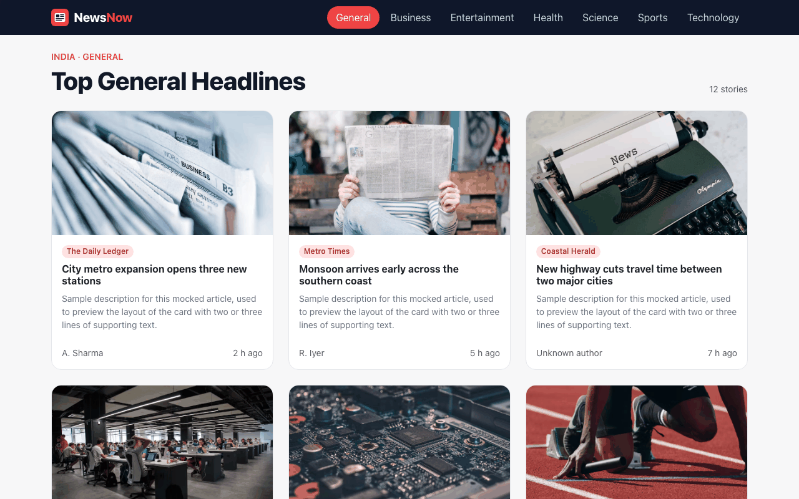
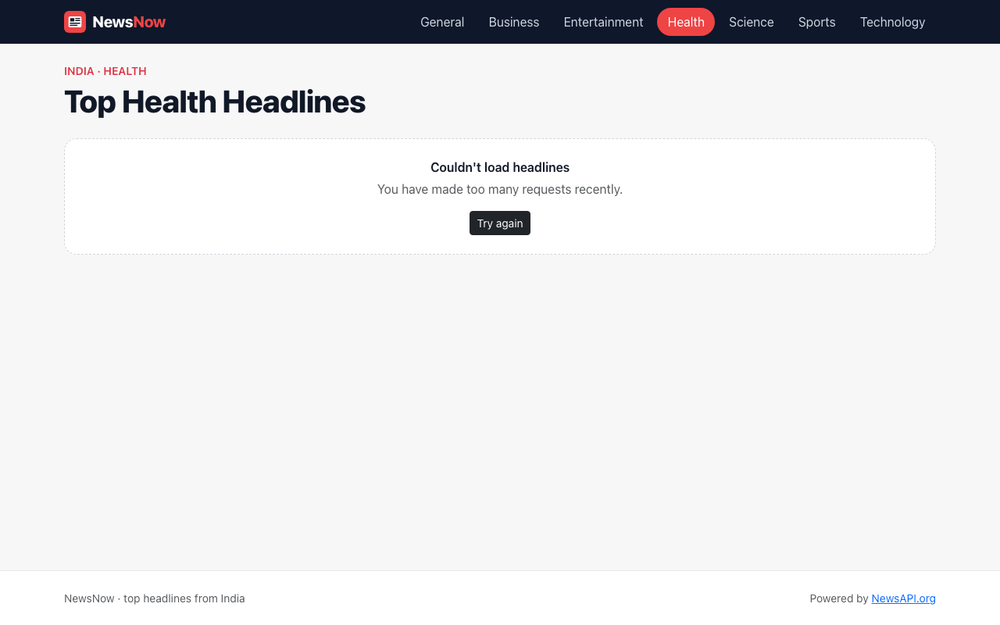

# NewsNow

A React news reader that shows top headlines from India by category, using the NewsAPI.org API with infinite scrolling.




| Error state | Mobile |
| ----------- | ------ |
|  |  |

_Screenshots use mocked sample articles._

## Overview

NewsNow is a client-side React app built with class components. Each category is its own route. For the selected category, the app fetches the [NewsAPI.org](https://newsapi.org/) `top-headlines` endpoint (`country=in`) and renders the articles as Bootstrap cards.

## Features

- Category routes: General (`/`), Business, Entertainment, Health, Science, Sports (`/sports`; the old `/sport` link redirects) and Technology, with the active category highlighted.
- Infinite scrolling with `react-infinite-scroll-component`, loading 9 articles per page, with duplicate articles filtered out and an end-of-list message.
- A top loading bar (`react-top-loading-bar`), skeleton cards while the first page loads and a spinner for later pages.
- Clear error messages from NewsAPI (missing or invalid key, rate limits) with a retry button, plus an empty state.
- Cards with the image (or a placeholder), the title, the description, the source, the author and a relative publish time. The whole card links to the full article in a new tab.
- The browser tab title updates for each category, for example `Business headlines · NewsNow`.

## Tech stack

- React 18 (class components), React Router 6
- Bootstrap 5 (via CDN in `public/index.html`)
- react-infinite-scroll-component, react-top-loading-bar
- NewsAPI.org REST API

## Project structure

```
NewsNow/
├── public/
└── src/
    ├── App.js              # routes (one per category) and the loading bar
    ├── categories.js       # category keys, labels and paths
    └── components/
        ├── Navbar.js       # category links
        ├── News.js         # fetching, pagination, infinite scroll, states
        ├── NewsItem.js     # article card
        └── Spinner.js      # loading indicator
```

## Getting started

### Prerequisites

- Node.js 18 or later and npm
- A free API key from [newsapi.org](https://newsapi.org/register)

### Install and run

```bash
git clone https://github.com/VamsiKrishnaThota03/news-now.git
cd NewsNow
npm install
cp .env.example .env     # then put your key in it
npm start                # dev server on http://localhost:3000
```

Other scripts: `npm run build` (production build in `build/`), `npm test` (tests with mocked fetch) and `npm run deploy` (publishes `build/` with `gh-pages`).

### Environment variables

| Variable            | Required | Description          |
| ------------------- | -------- | -------------------- |
| `REACT_APP_API_KEY` | yes      | Your NewsAPI.org key |

`.env` is gitignored. Never commit it.

## Known limitations

- NewsAPI's free Developer plan only accepts browser requests from `localhost`, so a static deployment (GitHub Pages, Vercel, etc.) needs a paid plan or a small server-side proxy.
- Because this is a browser-only app, `REACT_APP_API_KEY` is bundled into the JavaScript and visible to anyone who opens the site. Only use a key you are happy to expose, or move the request behind a proxy.
- The app uses `BrowserRouter` without a `homepage`, so a GitHub Pages project-site deploy (`/NewsNow/`) needs a `basename` or `HashRouter` first.
- `npm audit` still reports issues in Create React App's build tooling (`react-scripts` 5) that need a breaking upgrade.
